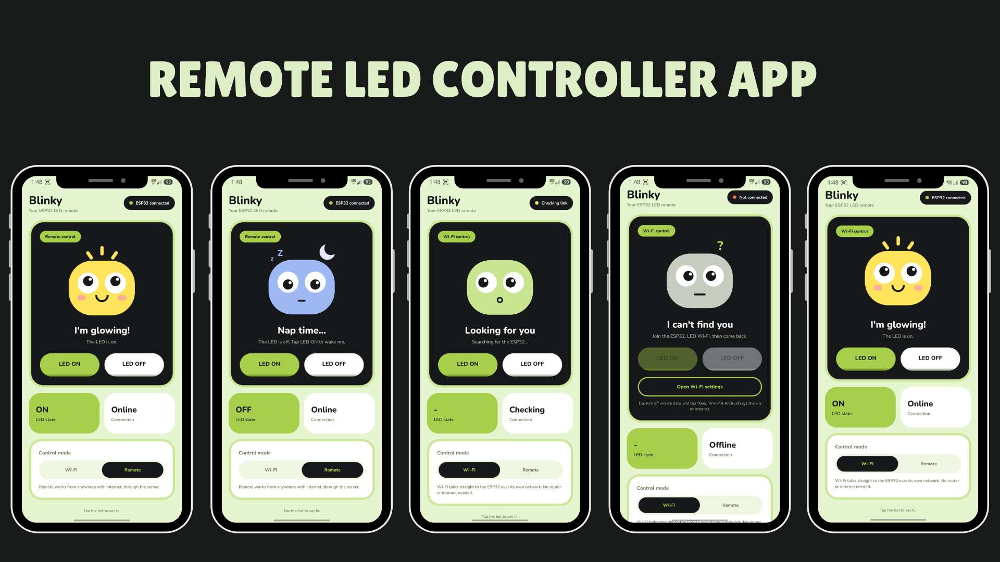

<p align="center">
  
</p>

# Blinky - Remote LED Controller

A playful mobile app that turns an LED on and off through an ESP32. Connect straight to the ESP32's own Wi-Fi, or control it from anywhere in the world over the internet.

Blinky is a cute googly-eyed bot that shows the LED's mood: glowing when it's on, sleepy when it's off, and lost when it can't find the ESP32.

## Features

- **LED ON / OFF buttons** with a live connection status indicator
- **Wi-Fi mode:** the phone connects directly to the ESP32's own network. No router or internet needed.
- **Remote mode:** control the LED from anywhere through a small cloud server
- **Animated bot** that reacts to the LED and connection state
- Built from scratch: no third-party IoT platforms, dashboards or app templates

## How it works

```
Wi-Fi mode:    Phone ──(ESP32_LED Wi-Fi)──► ESP32 ──► LED

Remote mode:   Phone ──(internet)──► Server ◄──(asks every 2 s)── ESP32 ──► LED
```

- In **Wi-Fi mode**, the ESP32 creates its own access point (`ESP32_LED`) and runs a tiny web server at `192.168.4.1`. The app sends `/on`, `/off` and `/status` requests to it.
- In **Remote mode**, the app sends the command to a Node.js server. The ESP32 checks the server every 2 seconds and applies the new state.

## Hardware

- ESP32 DevKit
- 1 LED
- 1 resistor (220 Ω)
- Jumper wires

**Wiring**

```
ESP32 pin D23 ──► 220 Ω resistor ──► LED long leg (+)
ESP32 pin GND ◄──────────────────── LED short leg (-)
```

## Tech stack

- **App:** React Native, Expo (Expo Router), TypeScript
- **Device:** ESP32 with the Arduino framework
- **Server:** Node.js, Express (hosted on Render)

## Project structure

```
led_controller/
├── src/app/index.tsx    # The whole app screen and logic
├── app.json             # Expo config (allows plain HTTP for Wi-Fi mode)
├── assets/              # Icons and banner
└── README.md
```

The server lives in its own repo (`led-server`) with a single `server.js` file.

## Getting started

### 1. ESP32

1. Open the sketch in the Arduino IDE and choose the **ESP32 Dev Module** board.
2. Set your home Wi-Fi name and password, the server URL and the secret key.
3. Upload it. If the upload fails, lower **Tools → Upload Speed** to `115200`.

### 2. Server

1. Push `server.js` and `package.json` to a GitHub repo.
2. Create a **Web Service** on Render with build command `npm install` and start command `npm start`.
3. Add an environment variable `LED_KEY` with your own secret word.

### 3. App

```
npm install
npx expo start
```

Scan the QR code with Expo Go to try it. Wi-Fi mode only works in a built APK.

In `src/app/index.tsx`, set:

```ts
const SERVER = 'https://your-app.onrender.com';
const KEY = 'your-secret-word';
```

### 4. Build the APK

```
eas build -p android --profile preview
```

## Settings that must match

| Setting | Where |
|---|---|
| Secret key | App `KEY`, ESP32 sketch `KEY`, Render `LED_KEY` |
| Server address | App `SERVER`, ESP32 sketch `SERVER_URL` (ends with `/api/device`) |

## Using the app

- **Wi-Fi mode:** join the `ESP32_LED` network, turn off mobile data, tap **Keep Wi-Fi** if Android asks, then open the app.
- **Remote mode:** use any internet connection. The ESP32 must be powered and connected to its home Wi-Fi.

## Troubleshooting

- **"I can't find you" in Wi-Fi mode:** check that the phone is on `ESP32_LED` with mobile data off. Test `http://192.168.4.1/status` in the phone browser.
- **"I can't find you" in Remote mode:** open `https://your-app.onrender.com/api/status`. If it shows `"online":false`, the ESP32 isn't reaching the server.
- **Wi-Fi mode works in Expo Go but not in the APK:** make sure `expo-build-properties` with `usesCleartextTraffic` is in `app.json`, then rebuild.
- **ESP32 upload error:** use a data USB cable and a lower upload speed.

## Notes

- The APK is Android only. iPhone users can open `http://192.168.4.1` in a browser while connected to `ESP32_LED`.
- The secret key is inside the app, so this is a demo-level setup, not production security.

## Author

Built by Smriti Naik.
